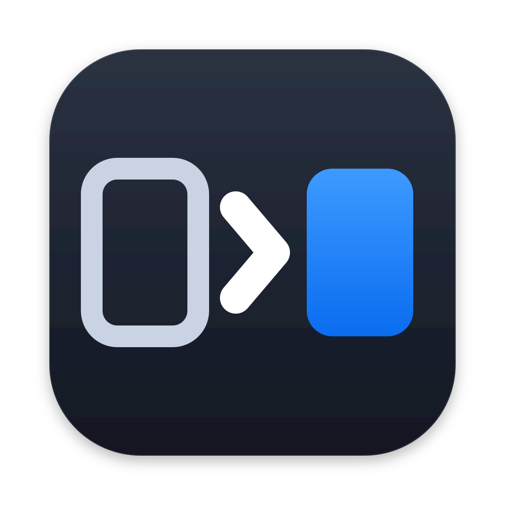

# jira-ado

A native macOS app that syncs Jira issues into Azure DevOps work items, one way (Jira → ADO). It's written in Swift with SwiftUI. Up to v0.2.4 it was a Go/MyGo app (see the git history).

## Features

### Set up once
- **Sign in with your ADO PAT.** With **Remember in Keychain** on, it's kept in the macOS Keychain and you stay signed in. The Jira API token always lives there, never in a file.
- **Create a sync job in 4 steps.** Pick the Jira project and the ADO project, choose which fields to copy (**Smart Defaults** picks them all), set filters, and review before saving.
- **Edit a job any time.** Change its fields, filters, area path or sprint settings with **Edit Job**, or jump straight to a step from the job's tabs.
- **Check before you sync.** **Check in ADO** (Filters step) confirms the area and iteration paths exist in ADO and, when sprints follow Jira, that Jira exposes its Sprint field. Every sync runs the same check first and stops before writing anything.

### What a sync does
- **Copies Jira issues into ADO work items.** By default issues become Product Backlog Items and sub-tasks become Tasks linked under their parent (change it on the Mappings page). Title, description, state, priority, assignee, dates and time tracking come along.
- **Keeps comments in step.** New Jira comments are added and edited ones are updated in place; comments deleted in Jira stay in ADO.
- **Only touches what changed.** Each run picks up where the last one stopped. Work items that are already up to date aren't rewritten, so ADO gets no needless revisions or notifications.
- **Puts work in the right sprint.** With weekly sprints on, an issue in the active Jira sprint goes to this week's ADO sprint. Anything else goes to the backlog, including issues taken out of a sprint.
- **Respects ADO.** A work item that is Done in ADO is never overwritten; the Jira change is left as a comment. Target date, original estimate and completed work already filled in ADO are kept, and differences are commented.
- **Copies attachments.** When the Jira issue has attachments, the work item's attachments are replaced with Jira's. When it has none, files attached in ADO are left alone.
- **Filters by person.** Sync only issues assigned to chosen people, and map Jira users to their ADO emails.

### Run it your way
- **Sync Now** for a real run, or **Dry Run** to see exactly what would be sent without changing anything in ADO.
- **Scheduler jobs** run on their interval (default 1 hour), also with the window closed. ⌘Q asks first while a sync is running.
- **Pause and Resume** a job; a paused job never syncs.
- **Watch it live.** The report fills in ticket by ticket while the sync runs, with a progress bar.
- **Cancel** a run safely. The next sync continues from where it stopped.
- **Retry failed** reruns only the tickets that failed, without re-reading everything else.
- **Get notified** when a run ends: every run, failures only, or off. Click the notification to open that run's report.
- **Update check**: once a day (and from **Check for Updates…**) the app looks at the latest GitHub release and, if it is newer, shows its notes with **Download**, **Skip This Version** and **Later**. It never installs anything by itself; turn it off in Settings → Updates.
- **Menu bar icon** shows a sync in progress or how many jobs are failing, with each job's state, Sync Now, Open and New Sync Job. It replaces the Dock icon; turn it off in Settings to use the Dock (with a badge counting failing jobs) instead.

### See what happened
- **Run report.** Created, updated, skipped and failed counts, then every ticket with what was written to ADO, with links to open it in Jira and in ADO. Sub-tasks are grouped under their parent.
- **Logs.** Every run of every job, filtered by job and status, exportable as JSON, deletable one by one or in bulk.
- **Activity Log** tab on each job lists what happened to it: creation, edits, pauses, runs and cancels.
- **Diagnostic log file**, opened from **Settings → Diagnostics**. It never contains tokens.

### Shared rules
- **Mappings page.** One list of Jira user → ADO email for every job, plus the rules for issue type → work item type, Jira status → ADO state and priority, with drop-downs loaded from your Jira and ADO projects.

### Getting around
- **⌘N** starts a new sync job; **⌘K** searches pages and jobs.
- **Appearance** in Settings: System, Light or Dark theme, a choice of three Dock icons (used when the menu bar icon is off), and the menu bar switch.

## Install

Download `jira-ado-<version>.dmg` (Apple Silicon + Intel) from the repository's **Releases** page. The app is signed ad hoc only: the first time, allow it in **System Settings → Privacy & Security → Open Anyway**, or run `xattr -dr com.apple.quarantine /Applications/jira-ado.app`.

### Moving from the Go app
The Swift app has the same bundle ID, so it replaces `/Applications/jira-ado.app`. Your PAT and Jira token carry over through the Keychain (macOS asks once).

## First run

1. **Sign in**: enter your ADO organization (the `<org>` in `dev.azure.com/<org>`) and a Personal Access Token with the **Work Items (Read & Write)** scope.
2. **Settings**: enter your Jira site URL, email and an [API token](https://id.atlassian.com/manage-profile/security/api-tokens), then click **Test Jira**.
3. **New Sync Job** (⌘N), then **Sync Now** and **View Report**.

## Development

Requires Xcode 26 or later (macOS 26 SDK); the project is maintained with Xcode 27. Conventions and architecture are in [CLAUDE.md](CLAUDE.md).

- Build: `xcodebuild -project jira-ado-swift.xcodeproj -scheme jira-ado-swift build`
- All tests (UI tests need Accessibility access for Xcode): `xcodebuild test -project jira-ado-swift.xcodeproj -scheme jira-ado-swift -destination 'platform=macOS'`
- Unit tests only: add `-only-testing:jira-ado-swiftTests`
- Demo data, no Jira/ADO calls: enable `JIRA_ADO_DEMO` in the scheme's Run environment

## Releases

CI (`.github/workflows/build.yml`) runs the unit tests on pushes to `main` and on pull requests, skipping docs/design-only changes. UI tests run locally only. To release, push a tag: `git tag v0.3.0 && git push origin v0.3.0`. CI builds a universal `jira-ado.app` with the tag's version, publishes the release with `jira-ado-<version>.dmg`, then commits that version to `MARKETING_VERSION` on `main` if it's newer (run `git pull` afterwards). **Actions → Build → Run workflow** builds on demand.
